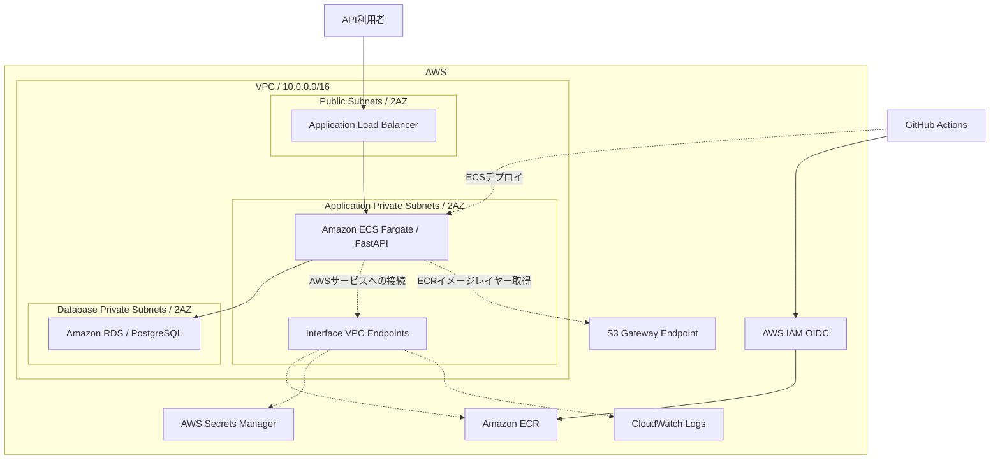
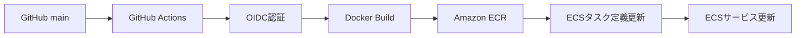

# AWS Task Management API

AWS上に構築した、タスク管理用REST APIのポートフォリオです。

Python / FastAPIで開発したアプリケーションをDockerでコンテナ化し、Amazon ECS Fargateで実行する構成です。

インフラはTerraformでコード管理し、GitHub ActionsとAWS IAM OIDC認証によるCI/CDパイプラインを実装しました。

**現在の状態（2026年11月10日時点）**

- 過去にAWS環境を構築し、APIとCI/CDの動作を確認済み
- 検証費用を抑えるため、AWS環境は削除済み
- TerraformをECS Fargate中心の構成に整理済み
- 最新構成の `terraform validate` は成功
- 最新構成でのAWS再構築・動作確認は未実施
- GitHub Actionsのワークフローは無効化中

## 主な実装内容

- FastAPIによるタスク管理REST API
- PostgreSQLへのデータ永続化
- Dockerによるコンテナ化
- Amazon ECS Fargateによるアプリケーション実行
- Application Load BalancerによるHTTPリクエストの振り分け
- TerraformによるAWSインフラ管理
- GitHub ActionsによるDockerイメージのビルド・ECRへのプッシュ・ECSへのデプロイ
- IAM OIDC認証によるGitHub ActionsとAWSの連携
- RDS管理のAWS Secrets ManagerによるDBパスワード管理
- CloudWatch Logsへのコンテナログ出力
- VPCエンドポイントによるプライベートネットワークからのAWSサービス接続

## 使用技術

| 分類 | 技術 |
|---|---|
| 言語 | Python |
| Webフレームワーク | FastAPI |
| データベース | PostgreSQL / Amazon RDS |
| コンテナ | Docker |
| コンテナ実行基盤 | Amazon ECS Fargate |
| コンテナレジストリ | Amazon ECR |
| ロードバランサー | Application Load Balancer |
| インフラ管理 | Terraform |
| CI/CD | GitHub Actions |
| 認証・権限管理 | AWS IAM / OIDC |
| シークレット管理 | AWS Secrets Manager |
| ログ管理 | Amazon CloudWatch Logs |

## システム構成図



※図はTerraformで意図した構成を表しています。最新構成での再構築・疎通確認は今後実施します。

※RDSインスタンスはシングルAZです。DB用サブネットは2AZに配置していますが、Multi-AZ DBインスタンスではありません。

## ネットワーク設計

VPC内にPublic Subnet、Application Private Subnet、Database Private Subnetをそれぞれ2AZ分用意しています。

| 用途 | AZ | CIDR |
|---|---|---|
| Public Subnet 1 | ap-northeast-1a | 10.0.1.0/24 |
| Public Subnet 2 | ap-northeast-1c | 10.0.2.0/24 |
| Application Private Subnet 1 | ap-northeast-1a | 10.0.11.0/24 |
| Application Private Subnet 2 | ap-northeast-1c | 10.0.12.0/24 |
| Database Private Subnet 1 | ap-northeast-1a | 10.0.21.0/24 |
| Database Private Subnet 2 | ap-northeast-1c | 10.0.22.0/24 |

ALBはPublic Subnetに配置し、ECS FargateはApplication Private Subnet、RDSはDatabase Private Subnetに配置します。

ALBのHTTPリスナーは、ECS用ターゲットグループへリクエストを転送する構成です。

NAT Gatewayを使用せず、以下のVPCエンドポイントを利用する設計です。

- ECR API：Interface Endpoint
- ECR DKR：Interface Endpoint
- CloudWatch Logs：Interface Endpoint
- Secrets Manager：Interface Endpoint
- Amazon S3：Gateway Endpoint

ECRのコンテナイメージ取得には、ECRのInterface Endpointに加えてS3への通信経路が必要です。

Application Private SubnetをS3 Gateway Endpointに関連付けたPrivate Route Tableへ接続する設定を追加済みです。実際の通信は再構築後に確認します。

## セキュリティ設計

### ネットワーク分離

- ALBをPublic Subnetに配置
- ECS FargateをApplication Private Subnetに配置
- RDS PostgreSQLをDatabase Private Subnetに配置
- ECSタスクへのパブリックIP割り当てを無効化
- RDSのパブリックアクセスを無効化
- Security Groupで必要な通信を制限
- ECSからRDSへのPostgreSQL接続を許可

### IAMと認証情報管理

- ECSタスク実行ロールに必要なAWS権限を付与
- RDSのマスターパスワードをAWS Secrets Managerで管理
- ECSタスク定義の `secrets` を使用してDBパスワードをコンテナへ渡す
- GitHub ActionsからAWSへの認証にOIDCを利用
- GitHub Actions用IAMロールにECR・ECSデプロイに必要な権限を設定
- AWSアクセスキーをGitHub Actionsに保存しない構成

OIDCの信頼ポリシーでは、AudienceとSubjectを条件として設定しています。

SubjectにはGitHubリポジトリの識別情報とmainブランチを含むカスタム形式を使用しています。過去のGitHub Actions実行ログで、実際のOIDC SubjectとTerraform設定が一致することを確認済みです。

### 現在の制限事項

- ALBはHTTP（ポート80）で公開する構成
- HTTPSおよび独自ドメインには未対応
- Terraform stateはローカル管理
- CloudWatchアラームは未実装
- 最新のSecrets Manager構成についてはAWS上での再検証が必要

## CI/CD

GitHub Actionsを使用し、mainブランチへのpushまたは手動実行を契機にデプロイする設計です。



### デプロイ処理

1. GitHubリポジトリからソースコードを取得
2. OIDCトークンを使用してAWS IAMロールを引き受け
3. Dockerイメージをビルド
4. コミットSHAおよび `v1` のタグでECRへプッシュ
5. 現在のECSタスク定義を取得
6. 新しいイメージを指定したタスク定義を登録
7. ECSサービスを更新

TerraformとGitHub Actionsが同じECSタスク定義の更新を競合しないよう、Terraform側ではECSサービスの `task_definition` の変更を無視する設定を使用しています。

現在はAWS環境を削除しているため、GitHub Actionsのワークフローを無効化しています。

## API一覧

| HTTPメソッド | エンドポイント | 機能 |
|---|---|---|
| GET | `/` | ルートエンドポイント |
| GET | `/health` | ヘルスチェック |
| GET | `/tasks` | タスク一覧取得 |
| POST | `/tasks` | タスク作成 |
| PATCH | `/tasks/{task_id}` | タスク更新 |
| DELETE | `/tasks/{task_id}` | タスク削除 |

タスクにはID、タイトル、完了状態、作成日時を保持します。

### 過去の動作確認結果

2026年11月9日、GitHub ActionsでデプロイしたECSタスク定義リビジョン2について、ALB経由で以下の動作を確認しました。

| 操作 | 結果 |
|---|---|
| GET `/health` | HTTP 200 |
| GET `/tasks` | HTTP 200 |
| POST `/tasks` | HTTP 200 |
| PATCH `/tasks/6` | HTTP 200 |
| DELETE `/tasks/6` | HTTP 200 |

POST・PATCH・DELETEによるPostgreSQLへの書き込み・更新・削除も確認済みです。

これらは2026年11月9日時点の構成での実績です。11月10日以降のTerraform変更については、再構築後の検証が必要です。

## Terraform

AWSインフラの構成コードは [`terraform/`](./terraform/) に格納しています。

主な管理対象：

- VPC・Subnet・Route Table
- Security Group
- Application Load Balancer
- Amazon ECS Fargate
- Amazon ECR
- Amazon RDS
- IAMロール・ポリシー
- GitHub OIDC Provider
- VPC Endpoints
- CloudWatch Logs

Terraform stateファイルや認証情報はGitHubの管理対象から除外しています。

### 前提条件

- AWSアカウント
- Terraform
- AWS CLI
- Docker
- Git
- 必要なAWS操作権限
- GitHub Actionsを使用する場合は、対象リポジトリの適切な権限

TerraformのAWS Providerは東京リージョン（`ap-northeast-1`）を使用します。

ローカル環境ではAWS CLIプロファイル `terraform-admin` を使用する設定です。

このプロファイル名は環境依存のため、別の環境で再現する場合は適切に変更する必要があります。

### Terraformコードの検証

リポジトリのルートディレクトリから実行します。

```bash
cd terraform
terraform init
terraform fmt -check
terraform validate
```

`terraform validate` は設定の整合性を検証しますが、AWS上での実際のリソース作成成功を保証するものではありません。

## AWS環境の再構築手順

**注意：以下は再構築時の作業手順です。最新構成ではまだ実行・検証していません。**

AWSリソースの作成により料金が発生します。

### 1. 事前確認

- AWS CLIの認証設定を確認
- Terraform stateの保存場所を確認
- AWSアカウントとリージョンを確認
- IAM・OIDC設定を確認
- RDSのエンジンバージョンとインスタンスタイプの利用可否を確認
- VPCエンドポイントとルートテーブルの設定を確認
- GitHub Actionsが無効になっていることを確認

### 2. Terraformの初期化と実行計画

```bash
cd terraform
terraform init
terraform validate
terraform plan
```

実行計画に意図しないリソースが含まれていないことを確認します。

### 3. AWSインフラの作成

実行計画を確認したうえで、必要な場合のみ実行します。

```bash
terraform apply
```

この時点でECSサービスの `desired_count` は0のため、アプリケーションタスクは起動しない構成です。

### 4. Dockerイメージの登録とデプロイ

Terraformによるインフラ作成後、GitHub ActionsからECRへのイメージ登録とECSデプロイを行います。

ワークフローにはOIDC認証、Dockerビルド、ECRへのプッシュ、ECSタスク定義更新、ECSサービス更新の処理が含まれています。

初回実行前には、GitHub Actionsの有効化、OIDC信頼ポリシー、ECSタスク定義、ECRリポジトリを確認します。

### 5. ECSサービスの起動

Dockerイメージ登録後、ECSサービスのDesired Countを1以上に変更して起動します。

起動方法はTerraform管理値との整合性を考慮して選択します。

### 6. 動作確認

- ECSタスクが正常起動していること
- ALBターゲットグループがHealthyであること
- `/health` がHTTP 200を返すこと
- `/tasks` の取得・作成・更新・削除が成功すること
- RDSへの接続が成功すること
- CloudWatch Logsへログが出力されること

動作確認後は、不要なリソースを停止または削除します。

## AWS環境の削除手順

**注意：Terraformによる削除は実際のAWSリソースとデータを削除します。**

実行前に、対象AWSアカウント、リージョン、Terraform state、削除対象を確認してください。

### 1. Terraform stateの確認

```bash
cd terraform
terraform state list
```

### 2. 削除計画の確認

```bash
terraform plan -destroy
```

削除対象に問題がないことを確認します。

### 3. Terraform管理リソースの削除

```bash
terraform destroy
```

### 4. 削除後の確認

Terraform管理外に残ったリソースがないか、AWSコンソールやAWS CLIで確認します。

主な確認対象：

- EC2 / ECS
- ALB
- RDS・スナップショット
- ECRリポジトリ
- VPCエンドポイント
- CloudWatch Logs
- Secrets Manager
- S3バケット
- その他の課金対象リソース

Terraform管理外のリソースは `terraform destroy` では削除されません。

また、Terraform stateの削除や紛失は、AWSリソースが削除されたことを意味しません。

## 監視・運用

- ECSコンテナログをCloudWatch Logsに出力
- ALBのターゲットヘルスチェックを利用
- ECSサービスのタスク数・稼働状態をAWS CLIで確認
- Terraformの `plan` と `validate` によってインフラ設定を検証
- 動作確認後は不要なAWSリソースを削除して費用を抑制

### コスト管理

検証環境のため、常時稼働は行いません。

ECSタスクを停止しても、ALB、VPC Interface Endpoint、RDSなどには料金が発生する場合があります。

RDSは手動停止後、最大7日で自動再起動されるため、長期間利用しない場合は削除を検討します。

2026年11月10日にAWS環境を削除しました。

今後再構築する場合も、検証期間を限定し、作業終了後に課金対象リソースが残っていないか確認します。

## 開発経緯と設計判断

### EC2からECS Fargateへの移行

初期段階ではEC2上でFastAPIを実行する構成を構築しました。

その後、コンテナ運用とCI/CDを学習するため、Docker・ECR・ECS Fargateを利用する構成へ移行しました。

2026年11月10日、Terraformの実行対象から旧EC2関連リソースを除外し、ALBの転送先をECSへ統一しました。

旧EC2構成のコードはGitの過去のコミットから参照できます。

### Private Subnetの採用

アプリケーションとデータベースをインターネットへ直接公開しないため、ECSとRDSをPrivate Subnetに配置しています。

### NAT Gatewayを使用しない理由

検証環境のため、NAT Gatewayの常時利用料金を避け、AWSサービスへの接続にはVPCエンドポイントを利用する構成を選択しました。

ただし、Interface Endpointにも時間単位の料金が発生するため、常時稼働環境での費用優位性は別途比較が必要です。

### TerraformとGitHub Actionsの役割分担

TerraformはAWSインフラを管理し、GitHub Actionsはアプリケーションのビルド・イメージ登録・ECSデプロイを担当します。

これにより、インフラ管理とアプリケーション更新の責務を分離しています。

## 今後の改善点

- 最新Terraform構成での再構築・動作確認
- S3 Gateway Endpoint経由でのECRイメージ取得の実環境検証
- GitHub Actionsの初回デプロイ手順の再検証
- 自動テストのCI/CDへの組み込み
- HTTPS対応と独自ドメイン設定
- Terraformのリモートstate管理
- CloudWatchアラームの追加
- ECSのオートスケーリング
- シークレット管理・運用手順の改善
- コスト最適化の継続的な検証
